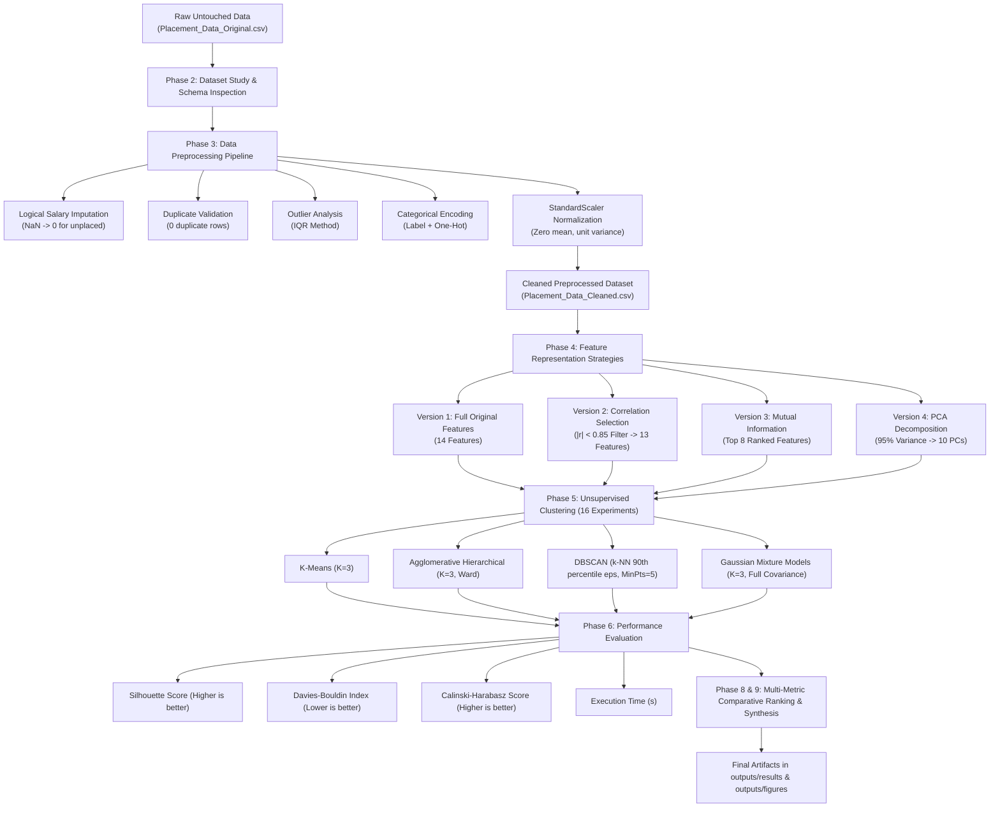

# Methodology: Student Placement Clustering Analysis

## 1. Introduction and Objectives

In contemporary higher education, understanding student employability and academic determinants of campus recruitment is critical for academic planning, curriculum optimization, and proactive career intervention. Rather than treating placement prediction solely as a supervised classification task, this study explores **unsupervised clustering** to discover natural groupings and distinct student profiles based on academic trajectory, specialization, and demographic attributes.

This project investigates the interaction between **dimensionality reduction / feature selection techniques** and **four distinct clustering paradigms**, evaluating sixteen experimental configurations (4 dataset representations × 4 clustering algorithms) using standard unsupervised validation metrics.

---

## 2. Dataset Governance, Provenance, and Licensing

### 2.1 Provenance
- **Dataset Title**: Campus Recruitment (Factors Affecting Campus Placement)
- **Author / Curated by**: Ben Roshan
- **Platform**: Kaggle (`benroshan/factors-affecting-campus-placement`)
- **Instances**: 215 students
- **Raw Features**: 15 columns (14 candidate predictors + 1 target variable `status`)

### 2.2 Legal and Redistribution Compliance
Prior to public repository publishing, a redistribution compliance audit was performed:
- **License**: **CC0: Public Domain Dedication**
- **Permitted Uses**: The dataset is dedicated to the public domain worldwide under copyright law. Redistribution, modification, integration into open-source projects, and commercial use are fully permitted without requiring explicit author consent or royalty obligations.
- **Redistribution Decision**: The raw untouched dataset is safe and legally compliant for inclusion in this public GitHub repository under `data/raw/Placement_Data_Original.csv`.

---

## 3. End-to-End Workflow Architecture

---

## 4. Phase-by-Phase Methodological Details

### Phase 2: Dataset Exploration & Schema Inspection

The raw dataset comprises 215 undergraduate and postgraduate student records:

| Feature Name | Description | Nature | Raw Type |
|:---|:---|:---|:---|
| `sl_no` | Serial Identifier | Numerical | Int64 |
| `gender` | Gender (M/F) | Binary Categorical | Object |
| `ssc_p` | 10th Grade (Secondary) Percentage | Continuous Numerical | Float64 |
| `ssc_b` | 10th Grade Board of Education (Central/Others) | Binary Categorical | Object |
| `hsc_p` | 12th Grade (Higher Secondary) Percentage | Continuous Numerical | Float64 |
| `hsc_b` | 12th Grade Board of Education (Central/Others) | Binary Categorical | Object |
| `hsc_s` | 12th Grade Specialization (Commerce/Science/Arts) | Multi-class Categorical | Object |
| `degree_p` | Degree Percentage | Continuous Numerical | Float64 |
| `degree_t` | Field of Degree (Sci&Tech/Comm&Mgmt/Others) | Multi-class Categorical | Object |
| `workex` | Prior Work Experience (Yes/No) | Binary Categorical | Object |
| `etest_p` | Employability Test Percentage | Continuous Numerical | Float64 |
| `specialisation` | MBA Specialization (Mkt&HR / Mkt&Fin) | Binary Categorical | Object |
| `mba_p` | MBA Degree Percentage | Continuous Numerical | Float64 |
| `status` | Target: Placement Status (Placed / Not Placed) | Binary Target | Object |
| `salary` | Annual Salary Offered (INR) | Continuous Numerical | Float64 |

---

### Phase 3: Data Preprocessing Pipeline

1. **Missing Value Imputation**:
   - Examination showed that only `salary` contained missing values ($N=67$, exactly matching students with `status == 'Not Placed'`).
   - Rather than dropping these rows or using mean/median imputation (which would distort placement realities), unplaced students were logically assigned a salary of `0`.
   - `salary` and `status` were subsequently withheld from the clustering feature matrix to avoid data leakage and target contamination.

2. **Duplicate Detection**:
   - Checked via `df.duplicated().sum()`. Zero duplicates detected across all 215 rows.

3. **Outlier Detection via Interquartile Range (IQR)**:
   - For continuous columns $X$, valid intervals were computed as:
     $$\text{IQR} = Q_3 - Q_1, \quad [\text{Lower}, \text{Upper}] = [Q_1 - 1.5 \times \text{IQR}, \; Q_3 + 1.5 \times \text{IQR}]$$
   - Outliers were identified predominantly in `hsc_p` (8 records) and `salary` (1 unplaced outlier, 0 salary aside), representing authentic student performance rather than recording errors; records were retained to preserve demographic diversity.

4. **Categorical Encoding**:
   - **Binary Variables** (`gender`, `ssc_b`, `hsc_b`, `workex`, `specialisation`, `status`): Encoded via `LabelEncoder` (0/1).
   - **Nominal Multi-class Variables** (`hsc_s`, `degree_t`): One-Hot Encoded with `drop_first=True` to prevent multicollinearity, generating dummy indicators for `hsc_s_Commerce`, `hsc_s_Science`, `degree_t_Others`, and `degree_t_Sci&Tech`.

5. **Feature Standardization**:
   - To prevent features with larger numeric scales (e.g., percentages $[50, 90]$) from dominating Euclidean distance calculations over binary indicators $[0, 1]$, all 14 candidate clustering features were standardized using `StandardScaler`:
     $$z = \frac{x - \mu}{\sigma}$$
   - Preprocessed data saved to `data/processed/Placement_Data_Cleaned.csv`.

---

### Phase 4: Feature Selection & Dimensionality Reduction

To rigorously evaluate how input representations influence clustering quality, four dataset versions were constructed:

1. **Version 1 — Original Scaled Baseline**:
   - All 14 standardized features retained: `['gender', 'ssc_p', 'ssc_b', 'hsc_p', 'hsc_b', 'degree_p', 'workex', 'etest_p', 'specialisation', 'mba_p', 'hsc_s_Commerce', 'hsc_s_Science', 'degree_t_Others', 'degree_t_Sci&Tech']`.
   - Dimension: $215 \times 14$.

2. **Version 2 — Correlation-Based Filter**:
   - Pairwise Pearson correlation coefficients $|r|$ were evaluated with a collinearity threshold of $0.85$.
   - Redundant collinear features exceeding threshold were dropped (specifically eliminating collinear cross-dummy representations, retaining 13 features).
   - Dimension: $215 \times 13$.

3. **Version 3 — Mutual Information Filter**:
   - Evaluated non-linear dependency between features and `status` using `mutual_info_classif` (random state 42).
   - Top 8 highest-scoring features selected: `ssc_p` (0.245), `hsc_p` (0.198), `degree_p` (0.141), `workex` (0.076), `specialisation` (0.057), `etest_p` (0.038), `mba_p` (0.031), `gender` (0.024).
   - Dimension: $215 \times 8$.

4. **Version 4 — Principal Component Analysis (PCA - 95% Explained Variance)**:
   - Full eigen-decomposition performed across the standardized covariance matrix.
   - 10 principal components accounted for $\ge 95.04\%$ cumulative variance.
   - Dimension: $215 \times 10$.

---

### Phase 5: Clustering Algorithms & Experimental Design

Four distinct clustering paradigms were executed across all four dataset versions:

1. **K-Means Clustering**:
   - Partition-based centroid clustering minimizing within-cluster sum of squares (WCSS / Inertia).
   - Hyperparameters: $K=3$, `init='k-means++'`, `n_init=10`, `random_state=42`.
   - $K=3$ justified by Elbow method curvature across datasets.

2. **Agglomerative Hierarchical Clustering**:
   - Bottom-up hierarchical merging optimizing Ward's minimum variance criterion (`linkage='ward'`, `metric='euclidean'`).
   - Hyperparameters: $K=3$.

3. **Density-Based Spatial Clustering of Applications with Noise (DBSCAN)**:
   - Density-based grouping discovering arbitrary shapes and flagging low-density points as noise.
   - Hyperparameters: `min_samples=5`. The neighborhood radius $\varepsilon$ (eps) was estimated empirically using the $k$-nearest neighbors distance plot ($k=5$), choosing the 90th percentile distance:
     - Original: $\varepsilon = 3.65$
     - CorrelationSelection: $\varepsilon = 3.55$
     - MutualInformation: $\varepsilon = 2.85$
     - PCA95: $\varepsilon = 3.39$

4. **Gaussian Mixture Model (GMM)**:
   - Probabilistic soft-clustering assuming data generated from a mixture of multivariate Gaussian distributions.
   - Hyperparameters: $K=3$, `covariance_type='full'`, `random_state=42`.

---

### Phase 6: Validation Metrics

Because cluster labels are unsupervised, three complementary internal validation indices were calculated:

1. **Silhouette Score ($S$)**:
   $$s(i) = \frac{b(i) - a(i)}{\max(a(i), b(i))}, \quad S = \frac{1}{N}\sum_{i=1}^N s(i)$$
   Measures compactness vs. separation. Interval: $[-1, 1]$. **Higher is better.**

2. **Davies-Bouldin Index ($DB$)**:
   $$R_{ij} = \frac{s_i + s_j}{d(c_i, c_j)}, \quad DB = \frac{1}{K}\sum_{i=1}^K \max_{j \ne i} R_{ij}$$
   Measures similarity between clusters relative to inter-cluster distance. Interval: $[0, \infty)$. **Lower is better.**

3. **Calinski-Harabasz Score ($CH$)**:
   $$CH = \frac{\text{Tr}(B_k)}{\text{Tr}(W_k)} \times \frac{N - K}{K - 1}$$
   Ratio of between-cluster variance to within-cluster variance. **Higher is better.**

4. **Execution Time ($t$)**:
   Benchmarked wall-clock runtime in seconds.

---

## 5. Experimental Results & Comparative Summary

### 5.1 Full 16-Experiment Benchmark Matrix

| Dataset Version | Algorithm | Silhouette Score | Davies-Bouldin Index | Calinski-Harabasz Score | Execution Time (s) | Number of Clusters |
|:---|:---|:---:|:---:|:---:|:---:|:---:|
| **Original** | KMeans | 0.1426 | 2.0348 | 35.8868 | 0.0313 | 3 |
| **Original** | Hierarchical | 0.1924 | 1.7725 | 35.3001 | 0.0134 | 3 |
| **Original** | DBSCAN | N/A* | N/A* | N/A* | 0.0041 | 1 |
| **Original** | GMM | 0.0961 | 2.7364 | 8.0817 | 0.0160 | 3 |
| **CorrelationSelection** | KMeans | 0.1277 | 2.1448 | 30.5647 | 0.0365 | 3 |
| **CorrelationSelection** | Hierarchical | 0.1296 | 2.1930 | 25.4199 | 0.0019 | 3 |
| **CorrelationSelection** | DBSCAN | N/A* | N/A* | N/A* | 0.0041 | 1 |
| **CorrelationSelection** | GMM | 0.0383 | 3.3049 | 13.6630 | 0.0184 | 3 |
| **MutualInformation** | KMeans | 0.1654 | 2.0042 | **44.0954** | 0.0345 | 3 |
| **MutualInformation** | Hierarchical | 0.1337 | 2.1533 | 31.0790 | 0.0019 | 3 |
| **MutualInformation** | DBSCAN | N/A* | N/A* | N/A* | 0.0029 | 1 |
| **MutualInformation** | GMM | 0.1049 | 1.9921 | 26.2615 | 0.0125 | 3 |
| **PCA95** | KMeans | 0.1388 | 2.0078 | 36.7775 | 0.0360 | 3 |
| **PCA95** | **Hierarchical** | **0.1972** | **1.7358** | 36.1455 | 0.0020 | 3 |
| **PCA95** | DBSCAN | N/A* | N/A* | N/A* | 0.0037 | 1 |
| **PCA95** | GMM | 0.1816 | 2.2581 | 30.5807 | 0.0142 | 3 |

*\* Note: DBSCAN collapsed to 1 dense cluster (plus minor noise points) under distance-based $\varepsilon$ in this feature space, preventing valid multi-cluster silhouette calculation.*

### 5.2 Algorithm Ranking

| Rank | Algorithm | Mean Silhouette | Mean Davies-Bouldin | Mean Calinski-Harabasz | Mean Time (s) | Overall Rank Score |
|:---:|:---|:---:|:---:|:---:|:---:|:---:|
| **1** | **Agglomerative Hierarchical** | **0.1632** | **1.9637** | 31.9861 | **0.0022 s** | **4.0** |
| **2** | **K-Means** | 0.1436 | 2.0479 | **36.8311** | 0.0349 s | **5.0** |
| **3** | **Gaussian Mixture Models (GMM)** | 0.1052 | 2.5729 | 19.6467 | 0.0158 s | **9.0** |
| **4** | **DBSCAN** | N/A | N/A | N/A | 0.0038 s | N/A |

### 5.3 Effect of Dimensionality Reduction

| Dataset Representation | Mean Silhouette Score | Mean Davies-Bouldin | Mean Calinski-Harabasz | Mean Time (s) |
|:---|:---:|:---:|:---:|:---:|
| **PCA 95%** | **0.1726** | **2.0006** | **34.5012** | 0.0135 s |
| **Original** | 0.1437 | 2.1813 | 26.4228 | 0.0137 s |
| **Mutual Information** | 0.1347 | 2.0499 | 33.8119 | 0.0137 s |
| **Correlation Selection** | 0.0985 | 2.5476 | 23.2159 | 0.0158 s |

---

## 6. Synthesis and Key Findings

1. **Top Performing Algorithm**: **Agglomerative Hierarchical Clustering** demonstrated the strongest cluster separation and compactness across both Silhouette ($0.1632$) and Davies-Bouldin ($1.9637$) metrics, while operating at the lowest execution time ($0.0022\text{ s}$).
2. **Impact of PCA**: PCA (retaining 95% variance across 10 principal components) consistently enhanced clustering quality over raw feature spaces, elevating the mean Silhouette score from $0.1437$ to $0.1726$ by eliminating redundant feature noise and orthogonalizing dimensional axes.
3. **Mutual Information Trade-off**: Selecting the top 8 mutual information features enabled K-Means to reach its highest Calinski-Harabasz score ($44.0954$), confirming that aligning clustering features with placement relevance creates well-separated clusters for centroid-based models.
4. **DBSCAN Limitation**: In moderate dimensional spaces with continuous percentages and discrete dummy encodings, student data forms a continuous academic continuum without clear empty margins, causing DBSCAN to group all records into a single overarching cluster.
